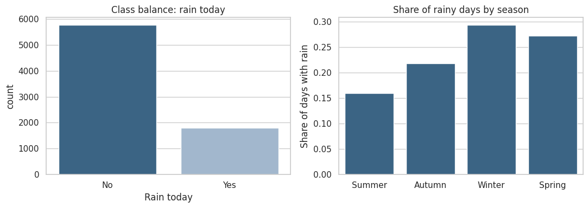
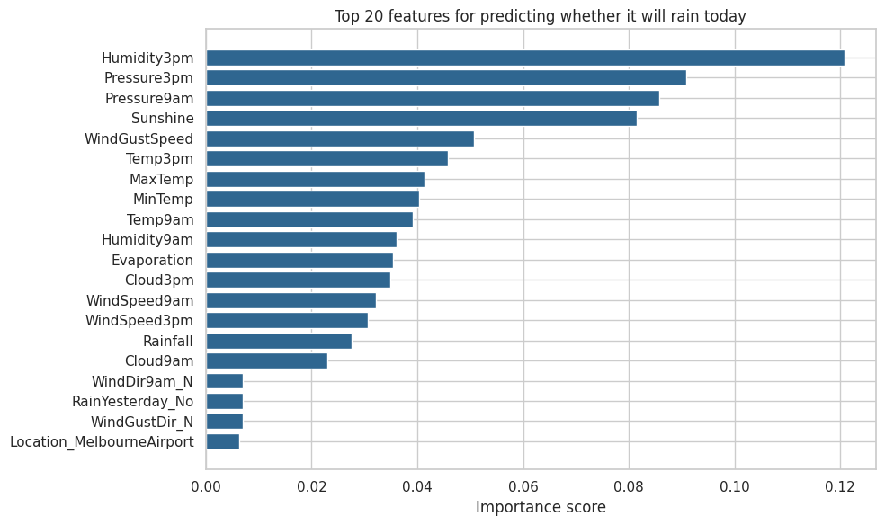
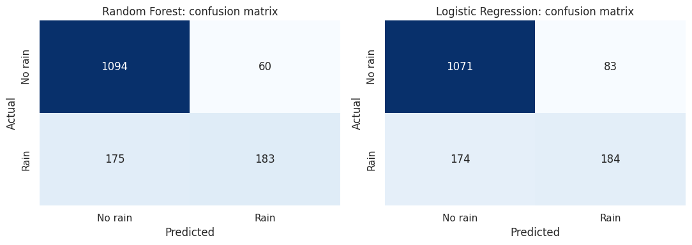

# 🌧️ Melbourne Rainfall Prediction

**An end-to-end machine learning pipeline that predicts whether it will rain today in Melbourne, using weather observations up to yesterday.**


Using daily observations from Australia's Bureau of Meteorology, I built and compared a **Random Forest** and a **Logistic Regression** model inside leak-free scikit-learn pipelines. The project focuses on doing the modelling *honestly*: avoiding data leakage, judging results against a naive baseline, and looking beyond accuracy on an imbalanced target.

The full notebook is [`Melbourne_Rainfall_Prediction.ipynb`](Melbourne_Rainfall_Prediction.ipynb). The project decisions are documented in the [PACE strategy document](docs/PACE_strategy_document.md).

---

## 📌 Problem

Predict **whether it rains today (Yes / No)** in the Melbourne area, using weather data recorded up to and including the previous day. A model like this supports everyday decisions such as whether to cycle to work or schedule outdoor activities.

## 🔑 Results

| Model | Test accuracy | Precision (rain) | Recall (rain) | F1 (rain) |
|---|--:|--:|--:|--:|
| Baseline: "always no rain" | 0.7630 | n/a | 0.0000 | n/a |
| **Random Forest (tuned)** | **0.8446** | **0.7531** | 0.5112 | **0.6090** |
| Logistic Regression (tuned) | 0.8300 | 0.6891 | 0.5140 | 0.5888 |

*Test set: 1,512 days (20% stratified hold-out of 7,557 Melbourne-area observations). It rains on 23.7% of days, about 87 days per year.*

**Takeaways**

- **Both models clearly beat the naive baseline**, but accuracy hides the real weakness: they catch only about **half of the rainy days** (183 of 358 for the Random Forest).
- The **Random Forest** is the better all-round model: similar recall to Logistic Regression with fewer false alarms (60 vs. 83), so higher precision and F1.
- The **most important feature is afternoon humidity (`Humidity3pm`)**, followed by 3pm and 9am pressure, sunshine hours and wind gust speed, which matches meteorological intuition.
- **Framing matters:** predicting "rain *today* from data up to yesterday" (instead of the dataset's original next-day target) removed same-day leakage and produced a realistic forecasting problem.

### Selected visuals

<p align="center">
  
  
</p>
<p align="center">
  
</p>

---

## 🧠 What this project demonstrates

- Cleaning a real-world weather dataset and reasoning about **data leakage** when defining the target
- **Feature engineering** (a `Season` feature from dates) and narrowing data granularity to a coherent region (Melbourne, Melbourne Airport, Watsonia)
- **Pipelines and `ColumnTransformer`** so scaling and one-hot encoding are re-fit inside every cross-validation fold
- **Hyperparameter tuning** with stratified 5-fold `GridSearchCV`
- Evaluation on **imbalanced classes** (precision / recall / F1, confusion matrices) instead of accuracy alone
- **Model comparison** and **interpretability** (feature importances)

## 📂 Repository structure

```
melbourne-rainfall-prediction/
├── README.md
├── Melbourne_Rainfall_Prediction.ipynb   # full analysis with outputs
├── download_data.py                      # re-downloads the dataset if needed
├── requirements.txt
├── LICENSE
├── .gitignore
├── data/
│   └── weatherAUS.csv                    # 145,460 rows × 23 columns
├── docs/
│   └── PACE_strategy_document.md         # PACE decisions, findings & reflections
├── images/                               # figures used in this README
└── scripts/
    └── push_to_github.ps1                # helper to push this repo (Windows)
```

## 🗂️ Dataset

Daily weather observations from the Australian Government's [Bureau of Meteorology](http://www.bom.gov.au/climate/dwo/), compiled on Kaggle as [Rain in Australia](https://www.kaggle.com/datasets/jsphyg/weather-dataset-rattle-package) (`weatherAUS.csv`): 145,460 rows from 49 locations, covering November 2007 to June 2017. After dropping rows with missing values and keeping the three Melbourne-area stations, **7,557 observations** remain. The notebook documents every column (temperature, rainfall, evaporation, sunshine, wind, humidity, pressure, cloud cover and rain flags).

## 🛠️ Tech stack

Python · pandas · NumPy · scikit-learn · matplotlib · seaborn · joblib · Jupyter

## ▶️ How to run

```bash
git clone https://github.com/sumitgawande3112-cmd/melbourne-rainfall-prediction.git
cd melbourne-rainfall-prediction

python -m venv venv
venv\Scripts\activate            # macOS/Linux: source venv/bin/activate

pip install -r requirements.txt
jupyter notebook Melbourne_Rainfall_Prediction.ipynb
```

Run the notebook from the repository root so the relative path `data/weatherAUS.csv` resolves. If the CSV is missing, the notebook (or `python download_data.py`) downloads it automatically. The final cell saves the trained pipeline to `models/` (ignored by Git).

## 🔭 Limitations & next steps

- Rows with missing values were dropped rather than imputed, which may bias the sample.
- A random stratified split can be slightly optimistic because neighbouring days are correlated. Next: a **time-based** train/test split.
- Models were selected on accuracy. Next: optimise for **recall or F1** on the rain class, tune the decision threshold and calibrate probabilities.
- Add imputation, lag features (rolling rainfall, pressure change) and gradient-boosted models such as `HistGradientBoostingClassifier`.
- Only three nearby stations are modelled; results may not transfer to other climate zones.

## 👤 Author

**Sumit Gawande** — [GitHub](https://github.com/sumitgawande3112-cmd)

## 📄 License

Code released under the [MIT License](LICENSE). The data comes from the Australian Bureau of Meteorology via the public Kaggle dataset and is used for educational purposes.
